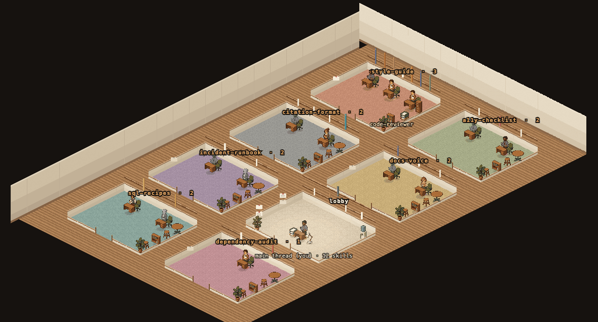
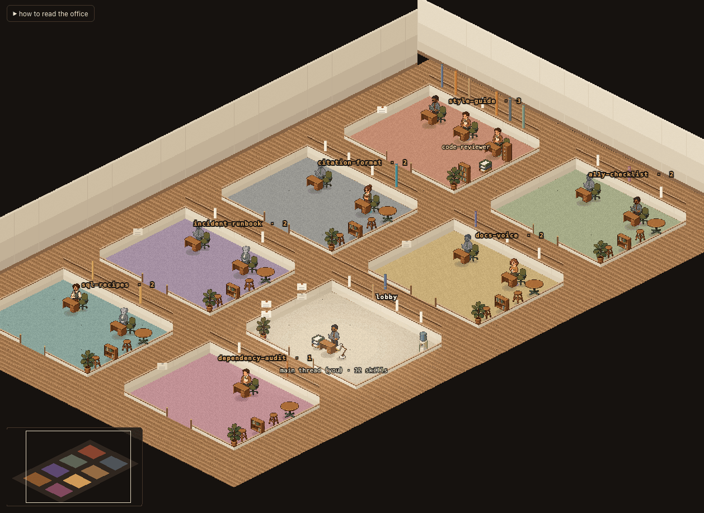
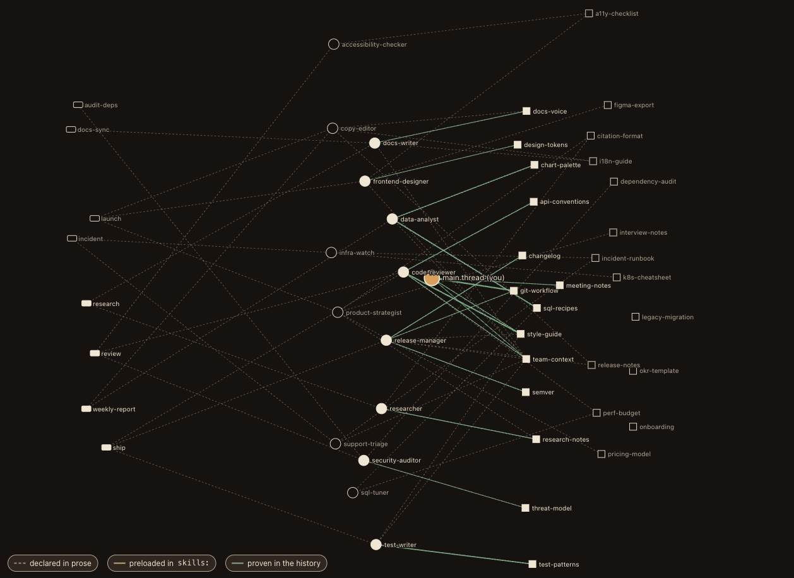
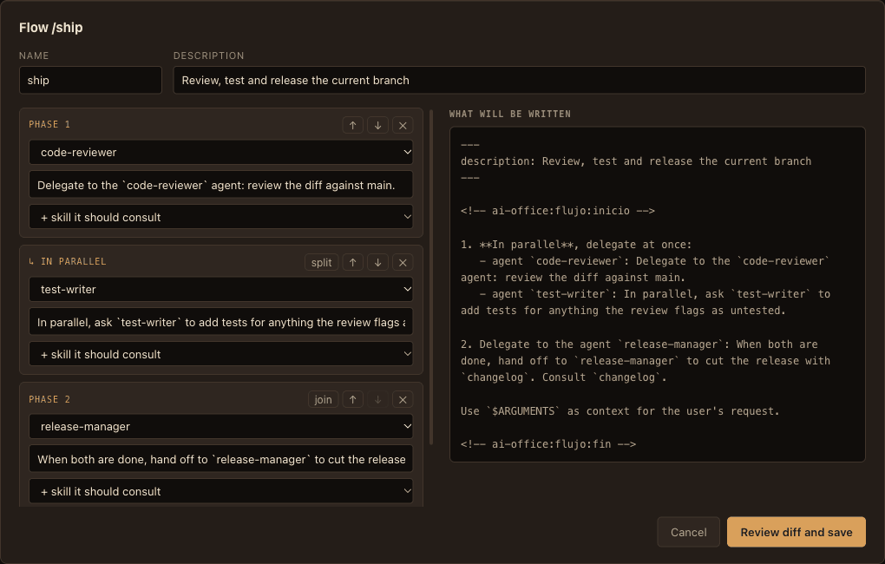

<div align="center">

# ai-office

**Ve, edita y mide tus agentes de Claude Code.**

[](https://www.npmjs.com/package/ai-office)
[](https://github.com/alex-roc/ai-office/actions/workflows/ci.yml)
[](LICENSE)
[](https://nodejs.org)

[**Demo en vivo**](https://alex-roc.github.io/ai-office/demo/?lang=es) · [Página del proyecto](https://alex-roc.github.io/ai-office/?lang=es) · [Read in English](README.md)



</div>

`ai-office` convierte tus **agentes, skills y slash commands** de Claude Code en una oficina en
pixel art y un grafo vivo. Mira cómo está organizado tu equipo, recámbialo sin miedo y mide qué
agentes y skills hacen de verdad el trabajo, todo a partir de los archivos que ya tienes en
`~/.claude`, sin salir de tu máquina.

```bash
npx ai-office --lang es          # la oficina, en tu navegador
npx ai-office census --lang es   # las cifras, en tu terminal
npx ai-office demo --lang es     # una oficina ficticia, para editar sin riesgo
```

La interfaz y el CLI están en inglés por defecto y en español con el botón EN/ES, `--lang es` o
`AI_OFFICE_LANG=es` (en el plugin, la opción «language»).

## Ver

<table>
<tr>
<td width="50%"></td>
<td width="50%"></td>
</tr>
<tr>
<td><b>La Sala</b>: la planta de tu configuración en pixel art isométrico. Los despachos no son
temas inventados: salen de qué skills cita cada agente y qué comandos lo convocan, así que cada
puerta lleva el nombre de una skill o un comando de verdad y te dice por qué esa gente lo
comparte. La posición es dato: una figura en gris nunca ha sido delegada, la altura de un lomo es
lo asentada que está una skill y un lomo en blanco es una skill que nadie ha abierto.</td>
<td><b>El Plano</b>: el grafo de quién usa qué y quién llama a quién, con todas las capas a la
vez: punteado lo que tus prompts declaran, sólido lo que tus transcripts demuestran. Selecciona
cualquier cosa y la ficha lateral cita el archivo y la línea de cada afirmación.</td>
</tr>
</table>

El hallazgo que lo sostiene: **el grafo ya está escrito, en prosa.** Los agentes citan skills en
el cuerpo de su prompt (*«antes de trabajar, lee la skill style-guide»*), los comandos nombran a
los agentes que convocan y algunas skills declaran su clientela. Nada de eso es un campo
estructurado, así que ninguna otra herramienta lo ve. `ai-office` lo extrae, con el archivo y la
línea que justifican cada relación.

En el **vestíbulo** del centro estás tú, con el **archivo común** de las skills que cita media
planta enfrente del **depósito** de las que no reclama ningún agente. Con muchos despachos la
cámara tiene un paso de alejamiento y un **minimapa** que se puede pinchar y arrastrar.

Teclado: <kbd>1</kbd>/<kbd>2</kbd> cambian de vista, <kbd>/</kbd> busca cualquier agente, skill o
comando, <kbd>+</kbd> <kbd>-</kbd> <kbd>0</kbd> acercan, alejan y encuadran, <kbd>?</kbd> enseña la
leyenda y los atajos y <kbd>Esc</kbd> cierra diálogos o quita la selección.

## Editar



Todo lo que editas pasa por la misma puerta: **se enseña el diff antes de tocar el disco**, se
guarda una copia y queda una línea en el registro de auditoría. Nunca se borra nada.

- **Conecta un agente con una skill** arrastrando en el Plano: la cita queda escrita en su prompt.
- **Cambia el modelo o el color** de un agente desde su ficha.
- **Jubila una skill** (`disable-model-invocation`): es reversible, y su description deja de costar
  contexto en cada sesión.
- **Archiva un agente**: se aparta a `agents/.archive/` y vuelve con un clic.
- **Compón un slash command** en el lienzo de flujos: quién interviene, en qué orden y qué
  consulta. Los pasos de la misma fase corren en paralelo y la vista previa es el Markdown exacto
  que se va a escribir, en el idioma de la interfaz. Los comandos que ya tienes se importan al
  lienzo, estén escritos en inglés o en español.

## Medir

```
$ npx ai-office census --lang es

  agentes              14   6 no han trabajado en los últimos 90 días
  skills               28   14 sin usar en los últimos 90 días
  comandos propios      8   4 ejecutados alguna vez

  ratio activo  ████████░░░░░░░░░░░░░░░░  32%

  agente→skill citadas en su prompt   41  declaradas
  agente→skill demostradas            13  en el historial
```

Tus prompts dicen quién *debería* hacer qué; tus transcripts dicen quién lo *hizo*. `ai-office`
cruza las dos cosas en unos segundos, incluso sobre gigabytes de sesiones:

| Capa | De dónde sale | Qué afirma |
|---|---|---|
| **Disponible** | las skills instaladas | cualquiera puede invocarla, si el modelo lo decide |
| **Encomendada** | prosa del prompt del agente | su prompt se lo manda; nadie lo garantiza |
| **Precargada** | `skills:` del frontmatter | se carga siempre, cueste lo que cueste |
| **Acreditada** | tus transcripts | lo hizo, N veces, la última tal día |

- **Uso por agente, skill y comando**, con grados *sin estrenar → estrenada → en práctica →
  acreditada*. El grado satura y caduca a los 90 días: ninguna cifra mejora por gastar más.
- **Lo que cuestan las skills ociosas**: cuántos tokens de descriptions se cargan en cada sesión
  por skills que nadie usa.
- **La brecha entre lo declarado y lo demostrado**: en una instalación real, 66 relaciones
  agente→skill escritas en los prompts, 0 en el campo `skills:` y 13 demostradas en el historial.
- **En vivo**: con los hooks instalados, la oficina se anima mientras trabajas en otra ventana
  (los agentes se materializan al ser delegados y el lomo de una skill se ilumina al invocarse), y
  cada evento deja rastro permanente en las fichas.
- **Un cartel para compartir**: `npx ai-office census --poster mi-oficina.svg --lang es`.

## Instalar

Requiere **Node ≥ 22.18**.

```bash
npx ai-office --lang es            # o: npm i -g ai-office
```

**Como plugin de Claude Code** (para la actividad en vivo: los hooks los declara el plugin, así
que tu `settings.json` no se toca; añade los comandos `/census` y `/censo`):

```bash
claude plugin marketplace add alex-roc/ai-office
claude plugin install ai-office@ai-office
```

La primera vez, ejecuta `pnpm install --prod` dentro del directorio del plugin; `ai-office` te
dice el comando exacto si faltan las dependencias. Sin el plugin, `ai-office hooks install` añade
los hooks a `settings.json` (enseña el diff antes y no escribe nada sin `--yes`). No instales las
dos cosas a la vez: cada evento llegaría dos veces (`doctor` lo avisa).

Otros comandos: `ai-office doctor` (plugin, hooks, daemon y eventos pendientes) y
`ai-office --version`. Si usas varias cuentas de Claude Code, se respeta `CLAUDE_CONFIG_DIR`.

**Desde el código:** `git clone https://github.com/alex-roc/ai-office && cd ai-office && pnpm install && pnpm dev`.

## Principios

- **Nada sale de tu máquina.** Sin servidor remoto, sin telemetría, sin cuenta, sin red. El daemon
  local escucha solo en `127.0.0.1`, tras un token que cambia en cada arranque
  ([modelo de amenazas](SECURITY.md#español)). El relay de hooks no guarda lo que escribes: de
  `Write`, `Edit` y `Bash` solo salen el nombre del archivo y el tamaño.
- **Todo indicador cita su fuente.** Si una cifra no puede decir de qué archivo y campo sale, no se
  muestra. [docs/es/METRICAS.md](docs/es/METRICAS.md) documenta incluso la métrica que probamos y
  descartamos porque los datos no la sostenían.
- **El formato interno de Claude Code es frágil y se trata como tal.** El historial es
  enriquecimiento, nunca una dependencia de arranque: si cambia el formato, se pierde el
  historial, no el producto.

## Contribuir

Ver [CONTRIBUTING.md](CONTRIBUTING.md#español). Arquitectura:
[docs/es/ARQUITECTURA.md](docs/es/ARQUITECTURA.md). Los gotchas que ya costaron una sesión cada
uno: [docs/es/GOTCHAS.md](docs/es/GOTCHAS.md).

## Licencia

[MIT](LICENSE) © Alex Ojeda Copa. Los sprites se generaron con IA y se procesaron a mano (ver
[assets/README.md](assets/README.md)). Sin relación con Anthropic.
