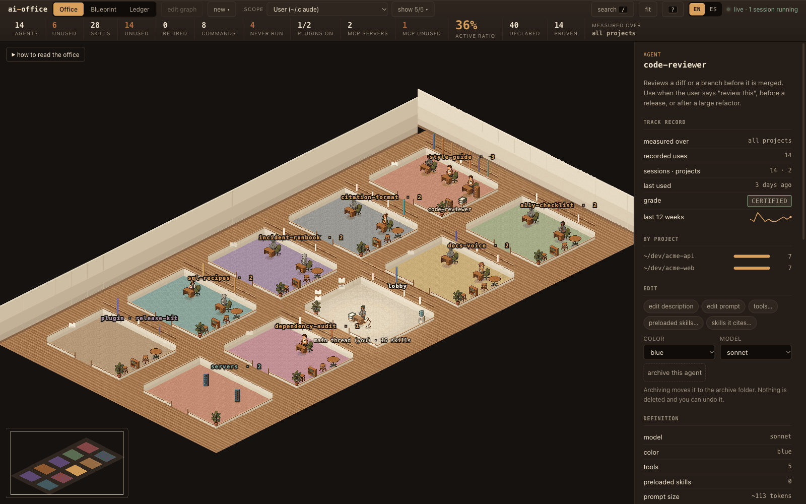
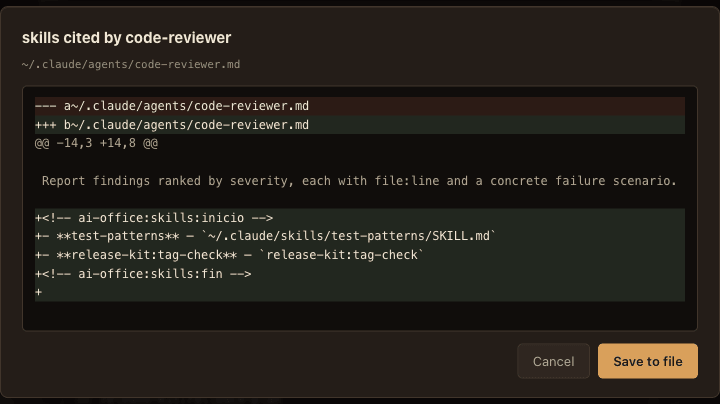
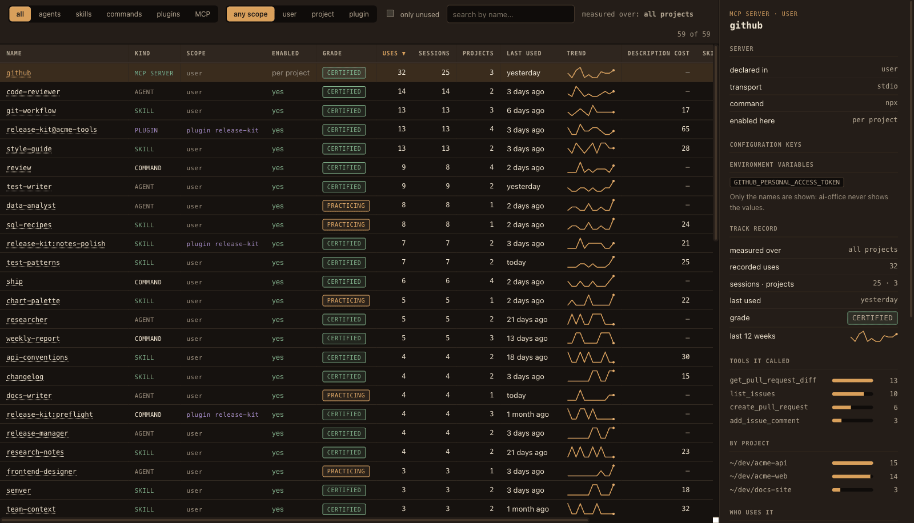

<div align="center">

# ai-office

**Ve, edita y mide tu configuración de Claude Code.**

Agentes · skills · slash commands · plugins · servidores MCP

[](https://www.npmjs.com/package/ai-office)
[](https://github.com/alex-roc/ai-office/actions/workflows/ci.yml)
[](LICENSE)
[](https://nodejs.org)

[**Demo en vivo**](https://alex-roc.github.io/ai-office/demo/?lang=es) · [Página del proyecto](https://alex-roc.github.io/ai-office/?lang=es) · [Read in English](README.md)


</div>

`ai-office` convierte todo aquello con lo que trabaja tu Claude Code —**agentes, skills, slash
commands, plugins y servidores MCP**— en una oficina en pixel art, un grafo vivo y un registro.
Mira cómo encaja, cámbialo sin miedo y descubre qué hace de verdad el trabajo. Lee los archivos que
ya tienes en `~/.claude` (y en el `.claude/` de tu proyecto), sin salir de tu máquina.

```bash
npx ai-office --lang es          # la oficina, en tu navegador (dentro de un proyecto: su ámbito)
npx ai-office census --lang es   # las cifras, en tu terminal
npx ai-office demo --lang es     # una oficina ficticia, para editar sin riesgo
```

La interfaz y el CLI están en inglés por defecto y en español con el botón EN/ES, `--lang es` o
`AI_OFFICE_LANG=es` (en el plugin, la opción «language»).

## Ver

<table>
<tr>
<td width="50%"></td>
<td width="50%"></td>
</tr>
<tr>
<td><b>La Sala</b>: la planta de tu configuración en pixel art isométrico. Los despachos salen de
qué skills cita cada agente y qué comandos lo convocan, así que cada puerta lleva el nombre de una
skill o un comando de verdad. Los plugins tienen su despacho y cada servidor MCP un rack en la sala
de servidores. La posición es dato: una figura en gris nunca ha sido delegada, la altura de un lomo
es lo asentada que está una skill y un rack apagado es un servidor al que nadie llama.</td>
<td><b>El Plano</b>: el grafo de quién usa qué, con agentes, skills, comandos, piezas de plugins
(con anillo) y servidores MCP (hexágonos). Punteado lo que tus prompts declaran, sólido lo que tus
transcripts demuestran. Selecciona cualquier cosa y la ficha cita el archivo y la línea de cada
afirmación, y abre el archivo ahí mismo.</td>
</tr>
</table>

El hallazgo que lo sostiene: **el grafo ya está escrito, en prosa.** Los agentes citan skills en
el cuerpo de su prompt (*«antes de trabajar, lee la skill style-guide»*) y los comandos nombran a
los agentes que convocan. Nada de eso es un campo estructurado, así que ninguna otra herramienta lo
ve. `ai-office` lo extrae, con el archivo y la línea que justifican cada relación.

## Editar



Todo lo que cambias pasa por la misma puerta: **se enseña el diff antes de tocar el disco**, se
guarda una copia y queda una línea en el registro de auditoría. Nunca se borra nada.

| | Qué puedes cambiar |
|---|---|
| **Agentes** | description, prompt, modelo, color, herramientas, skills precargadas y las skills que cita; archivar y restaurar; crear |
| **Skills** | description (junto a las palabras suyas que nunca escribes), el propio SKILL.md y a qué agentes está asignada; jubilar; crear |
| **Slash commands** | description, pista de argumentos y cuerpo, o componerlo en un lienzo de flujos (quién interviene, en qué orden, pasos en paralelo); crear |
| **Plugins** | activar o desactivar, en el archivo de settings que elijas. Los archivos del plugin son de solo lectura: las actualizaciones los sobrescriben |
| **Servidores MCP** | activar o desactivar por proyecto (Claude Code guarda ese estado por proyecto). Nunca se crean, editan ni borran |

## Medir



Tus prompts dicen quién *debería* hacer qué; tus transcripts dicen quién lo *hizo*. El
**Registro** lo pone todo en una tabla ordenable: usos, sesiones, proyectos, último uso, grado
(*sin estrenar → estrenada → en práctica → acreditada*), tendencia de 12 semanas, uso por proyecto,
llamadas por herramienta MCP y lo que cuesta en contexto la description de cada skill. Filtra «solo
sin usar» y tienes tu lista de limpieza.

```
$ npx ai-office census --lang es

  agentes              14   6 no han trabajado en los últimos 90 días
  skills               28   14 sin usar en los últimos 90 días
  comandos propios      8   4 ejecutados alguna vez

  ratio activo  █████████░░░░░░░░░░░░░░░  36%

  agente→skill citadas en su prompt   40  declaradas
  agente→skill demostradas            14  en el historial
```

| Capa | De dónde sale | Qué afirma |
|---|---|---|
| **Disponible** | las skills instaladas | cualquiera puede invocarla, si el modelo lo decide |
| **Encomendada** | prosa del prompt del agente | su prompt se lo manda; nadie lo garantiza |
| **Precargada** | `skills:` del frontmatter | se carga siempre, cueste lo que cueste |
| **Acreditada** | tus transcripts | lo hizo, N veces, la última tal día |

Con los hooks instalados, la oficina se anima mientras trabajas: los agentes se materializan al ser
delegados y el lomo de una skill se ilumina al invocarse. `npx ai-office census --poster mi-oficina.svg
--lang es` te da un cartel para compartir.

## Ámbito y qué se muestra

- **Usuario o proyecto.** El ámbito de usuario es `~/.claude`. El de un proyecto es lo que de verdad
  carga una sesión ahí —el `.claude/` del proyecto, tu configuración de usuario y los plugins
  activos, con las piezas del proyecto que tapan a las del usuario marcadas como tales—, y el uso se
  mide solo con las sesiones de ese proyecto. Se elige en la cabecera, con `--project <ruta>` o
  ejecutando `ai-office` dentro del proyecto.
- **Mostrar.** Activa o desactiva agentes, skills, comandos, plugins y servidores MCP en la Sala y el
  Plano para que nunca se saturen. El Registro lo lista siempre todo.
- La configuración vive en `~/.claude/ai-office/config.json`.

## Instalar

Requiere **Node ≥ 22.18**.

```bash
npx ai-office --lang es            # o: npm i -g ai-office
```

**Como plugin de Claude Code** (para la actividad en vivo: los hooks los declara el plugin, así que
tu `settings.json` no se toca; añade los comandos `/census` y `/censo`):

```bash
claude plugin marketplace add alex-roc/ai-office
claude plugin install ai-office@ai-office
```

La primera vez, ejecuta `pnpm install --prod` dentro del directorio del plugin; `ai-office` te dice
el comando exacto si faltan dependencias. Sin el plugin, `ai-office hooks install` añade los hooks a
`settings.json` (enseña el diff antes y no escribe nada sin `--yes`).

Otros comandos: `ai-office doctor` (ámbito, plugin, hooks, daemon y eventos pendientes) y
`ai-office --version`. Si usas varias cuentas de Claude Code, se respeta `CLAUDE_CONFIG_DIR`.

## Principios

- **Nada sale de tu máquina.** Sin servidor remoto, sin telemetría, sin cuenta, sin red. El daemon
  local escucha solo en `127.0.0.1`, tras un token que cambia en cada arranque
  ([modelo de amenazas](SECURITY.md#español)). Los secretos de los MCP no se enseñan nunca —solo los
  nombres de sus variables y cabeceras— y el relay de hooks no guarda lo que escribes.
- **Todo indicador cita su fuente.** Si una cifra no puede decir de qué archivo y campo sale, no se
  muestra. Por eso no hay coste en tokens de los servidores MCP: no se puede saber sin conectarse a
  ellos. [docs/es/METRICAS.md](docs/es/METRICAS.md) documenta incluso una métrica que probamos y
  descartamos porque los datos no la sostenían.
- **Ninguna cifra mejora por gastar más.** El grado satura y caduca a los 90 días.
- **El formato interno de Claude Code es frágil y se trata como tal.** El historial es
  enriquecimiento, nunca una dependencia de arranque. Lo que ai-office da por sentado está escrito en
  [docs/CLAUDE-CODE-CONFIG.md](docs/CLAUDE-CODE-CONFIG.md), con enlaces a la documentación oficial.

## Contribuir

Ver [CONTRIBUTING.md](CONTRIBUTING.md#español). Arquitectura, con la tabla exacta de qué se puede
ver, editar y medir: [docs/es/ARQUITECTURA.md](docs/es/ARQUITECTURA.md). Los gotchas que ya costaron
una sesión cada uno: [docs/es/GOTCHAS.md](docs/es/GOTCHAS.md).

## Licencia

[MIT](LICENSE) © Alex Ojeda Copa. Los sprites se generaron con IA y se procesaron a mano (ver
[assets/README.md](assets/README.md)). Sin relación con Anthropic.
